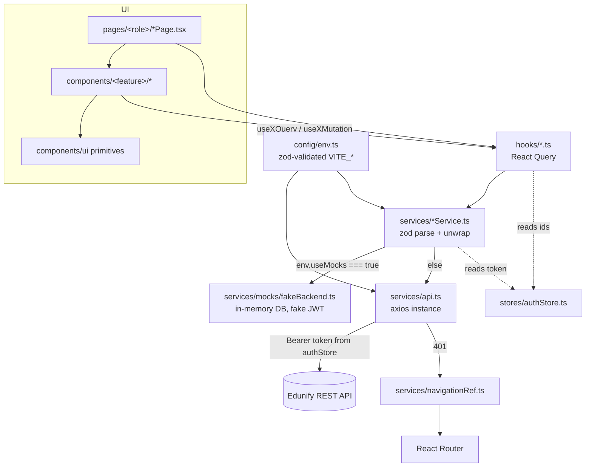

# Architecture

Snapshot as of 2026-10-04. Facts come from the code, and file:line refs point to `src/`. Where the code differs from `CLAUDE.md`, see `docs/TECH_DEBT.md`.

## Stack

| Concern | Choice (version from `package.json`) |
|---|---|
| Build | Vite 8, `@vitejs/plugin-react` 6, TypeScript ~6.0 (`strict`) |
| UI | React 19.2, React Router DOM 7 (`BrowserRouter` + `<Routes>`, not the data router) |
| Server state | `@tanstack/react-query` 5 (`new QueryClient()` with defaults, `src/App.tsx:8`) |
| Client state | Zustand 5 (`persist`) |
| HTTP | Axios 1.x, one instance in `src/services/api.ts` |
| Validation | zod 4 |
| Styling | Tailwind v4 via `@tailwindcss/vite` with no config file. Colors are runtime CSS variables. |
| i18n | i18next 26 + react-i18next 17 (`en`/`ru`/`uz`) |
| Icons | lucide-react |
| Mock data | `@faker-js/faker` (in `dependencies`, see TECH_DEBT) |

Package manager: npm (`package-lock.json`). Scripts: `dev`, `build` (`tsc -b && vite build`), `lint`, `preview`. There are no tests. The package is named `edunova`.

## Bootstrap

1. `src/main.tsx`: `StrictMode` → `<App/>`. Importing `./index.css` and `./i18n` for their side effects sets up i18n before the first render.
2. `src/App.tsx`: `QueryClientProvider` → `BrowserRouter` → `NavigationBridge` + `AppRoutes` + `Toaster`.
   - **There is no `ErrorBoundary`** anywhere in `src`.
3. `src/routes/index.tsx`: `AuthBootstrap` (outside `<Routes>`) plus the route table.
4. `src/stores/themeStore.ts` applies the theme once when the module loads (`syncAppliedTheme`).

## Layers

How a call flows: component → hook (`src/hooks`) → service (`src/services/<domain>Service.ts`) → transport.

- **Mock transport:** the service calls `mockApi.*` from `src/services/mocks/fakeBackend.ts` and passes the token explicitly as `useAuthStore.getState().token ?? ''`. Mock calls never go through the axios interceptors.
- **Real transport:** `api.get/post/...`. The interceptor attaches the JWT and normalizes errors.
- Both paths return the envelope `{ ok: true, data } | { ok: false, error, status }`. Each service turns it into data or throws `ApiError` using a local `unwrap()`, which is copied into all 7 services. The same zod schema then parses the data.

### `src/config/env.ts`
zod parses `VITE_API_URL` (required, even in mock mode) and `VITE_USE_MOCKS` (optional string). It exports `env = { apiUrl, useMocks }`. Nothing else reads `import.meta.env`.

### `src/services/api.ts`
- `ApiError(message, status)` is at :7-14 and the `Envelope<T>` type at :17-19.
- The instance (:21-25) uses `baseURL = env.apiUrl`, a JSON content type and a 15s timeout.
- The request interceptor (:28-32) adds `Authorization: Bearer <token>` when a token exists.
- The response interceptor (:37-51) **resolves** every error into `{ ok:false, error, status }`.
  - The message comes from `data.error`, then `data.message`, then `error.message`, then `'Request failed'`.
  - A network error gets `status 0`.
  - On a `401` it calls `clearSession()` and `navigateTo('/')`.
  - A `403` gets no special treatment, and the session is not cleared.
- `navigateTo` is a module-level ref (`src/services/navigationRef.ts`) that `src/components/layout/NavigationBridge.tsx` fills in. No `window.location` redirects.

### Services (`src/services`)
| File | Surface |
|---|---|
| `authService.ts` | `login`, `signup`, `me` |
| `orgService.ts` | `getOrg`, `resolveActiveOrganization`, `patchOrgTheme`, `patchOrgLogo` (FormData) |
| `branchService.ts` | branch CRUD; list/assign/remove managers, administrators, teachers; create staff (13 fns) |
| `profileService.ts` | get/update profile, change password |
| `connectionService.ts` | connection status, submit connection request (branch ID) |
| `statisticsService.ts` | `getStatistics`. When there is no `branchId` it aggregates on the client across `listBranches` using `src/utils/aggregateBranchStatistics.ts`. |
| `managerHomeService.ts` | `getBranchOverview` |

List functions parse `pageSchema(...)` (`src/schemas/branchSchemas.ts:49-55`) and **return only `.items`**. No page params are sent.

### Mock backend: `src/services/mocks/fakeBackend.ts` (2088 lines)
- It exports a single `api` object (about 60 async methods, starting at :1071), plus the domain TS types (:61-221) and `Page<T>`/`Result<T>`.
- **In-memory only.** A page reload resets the data. The data is seeded deterministically (`faker.seed(20260316)`): 2 orgs (bfa.uz with 2 branches, iec.uz with 1). Pinned demo logins are listed in `docs/apiContract.md`.
- Every call has 80ms of simulated latency (`LATENCY_MS`, :232).
- The fake JWT (:327-354) is base64 `header.payload.signature` with a 7-day `exp`, verified on every protected call.
- Guards (:991-1067): `requireAuth` (401), `requireRoles`, `requireOrgAccess`, `requireOrgOwner`, `requireBranchStaff`, `requireTeacherSelf`, `requireClassTeacher` (all 403).
- It is imported **statically** by every service, so it ships in production builds.

## State

| Kind | Where |
|---|---|
| Server state | React Query hooks in `src/hooks/use*Query.ts` / `use*Mutation.ts` |
| Auth / session | `src/stores/authStore.ts` (persist `auth`): `token`, `user`, `organizationId`, `branchId`, `organizationBranding`. Actions: `setSession`, `setUser`, `setOrganizationBranding`, `updateOrganizationBranding`, `clearSession`. |
| Theme mode | `src/stores/themeStore.ts` (persist `theme`): light/dark |
| Language | `src/stores/languageStore.ts` (persist `language`). `src/i18n/index.ts` reads Zustand's persisted JSON to set the starting language. This breaks a CLAUDE.md rule. |
| Toasts | `src/stores/toastStore.ts` + `src/components/ui/Toaster.tsx` (auto-dismiss after 4s) |

### Query keys actually in use
`['auth','me']`, `['profile']`, `['connection','status']`, `['org',orgId]`, `['org',orgId,'branches',branchId,'overview']` (`useBranchOverviewQuery.ts:9`), `['activeOrganization',uniqueId]`, `['branches',orgId]`, `['branchStudentCounts',orgId]`, `['branchManagers',orgId,branchId]`, `['branchAdministrators',orgId,branchId]`, `['branchTeachers',orgId,branchId]`, `['statistics',orgId,branchId|'overall',from,to]`.

Most of these are flat. They do **not** follow the `['org', orgId, 'branches', ...]` hierarchy in CLAUDE.md.

## Auth flow

1. **Login and signup.** `LoginForm` / `SignupForm` call `useLoginMutation` / `useSignupMutation`, which run `authService`. On success:
   - `authStore.setSession`
   - `setQueryData(['auth','me'])`
   - invalidate `me` and `activeOrganization`
   - navigate to `/home`
2. **Bootstrap.** `src/routes/AuthBootstrap.tsx` runs `useCurrentUserQuery` (`GET /auth/me`, `retry:false`, only when a token exists). It then:
   - syncs `user` back into the store
   - applies org branding through `useActiveOrganizationQuery`
   - on a 401, calls `clearSession()` and `navigate('/')` (:30-35). This is the only 401 path in mock mode.
3. **Logout.** `src/hooks/useLogout.ts` calls `clearSession()`, removes only `['auth','me']`, and navigates to `/`.
4. **Activation gating.** The backend or mock returns 403 on login for a director or teacher who is not activated. `LoginForm.tsx:39` shows a specific message for that.

## Routing (`src/routes/index.tsx`)

| Path | Element | Guard |
|---|---|---|
| `/` | `RootRoute`: `/home` if authenticated, else `pages/HomePage` (role picker) | none |
| `/home` | `SharedHome` (role → `*HomePage`, all 7 roles) | `RequireAuth` |
| `/profile`, `/profile/change-password` | `ProfilePage`, `ChangePasswordPage` | `RequireAuth` |
| `/appearance`, `/home/appearance` | `AppearancePage` (director only, checked inside the page) | `RequireAuth` |
| `/management` | `SharedManagement` (director, manager) | `RequireAuth` |
| `/payments`, `/classes`, `/students` | `SharedPayments` / `SharedClasses` / `SharedStudents` (manager only) | `RequireAuth` |
| `/edunify-admin`, `/director`, `/manager`, `/administrator`, `/teacher`, `/student`, `/parent` | `<Role>Page` → `components/layout/RoleLanding` (login/signup modal) | `RequireRole` |
| `/home/profile`, `/home/profile/appearance`, `/home/theming` | redirects | none |

- There is no catch-all `*` route.
- `RequireAuth` (`src/routes/RequireAuth.tsx:9`) redirects to `/` when there is no token or no user.
- **`RequireRole` ignores its `role` prop.** It is a "guests only" guard: logged-in users are sent to `/home`. The `Shared*` dispatchers do the per-role gating: they map `user.role` to a component and send other roles to `/home`.

## Layout

There is no shared shell or `<Outlet>` layout. Each page builds its own chrome:

- `AppHeader` for most authenticated pages.
- `ManagerHeader` + `ManagerBottomNav` for manager pages. `ManagerBottomNav` is a thin wrapper over the generic `StaffBottomNav`.
- `PublicHeader` for landing pages.
- `RoleHome` is the generic home shell. Manager and administrator homes are wrapped in `components/connection/RoleHomeWithConnection`.
- `HomeHeaderMenu` holds `LanguageSwitcher` and `ThemeToggle`.

## Theming / branding

- The 21 `--color-*` tokens and their defaults are in `src/schemas/themeSchemas.ts` (`THEME_COLOR_KEYS`, `themeColorsSchema`, `defaultLightTheme`, `defaultDarkTheme`).
- `src/theme.ts` `applyTheme` writes the tokens with `root.style.setProperty` and sets `data-theme`.
- `src/utils/syncTheme.ts` chooses the org branding (from `authStore`) or the defaults.
- `src/index.css` imports Tailwind and sets `body { background: var(--color-surface) }`. It defines no CSS fallback tokens.
- Org name and logo come from `src/hooks/useActiveOrganizationBranding.ts`. The document title and favicon come from `src/hooks/useDocumentBranding.ts` and `src/utils/favicon.ts`.
